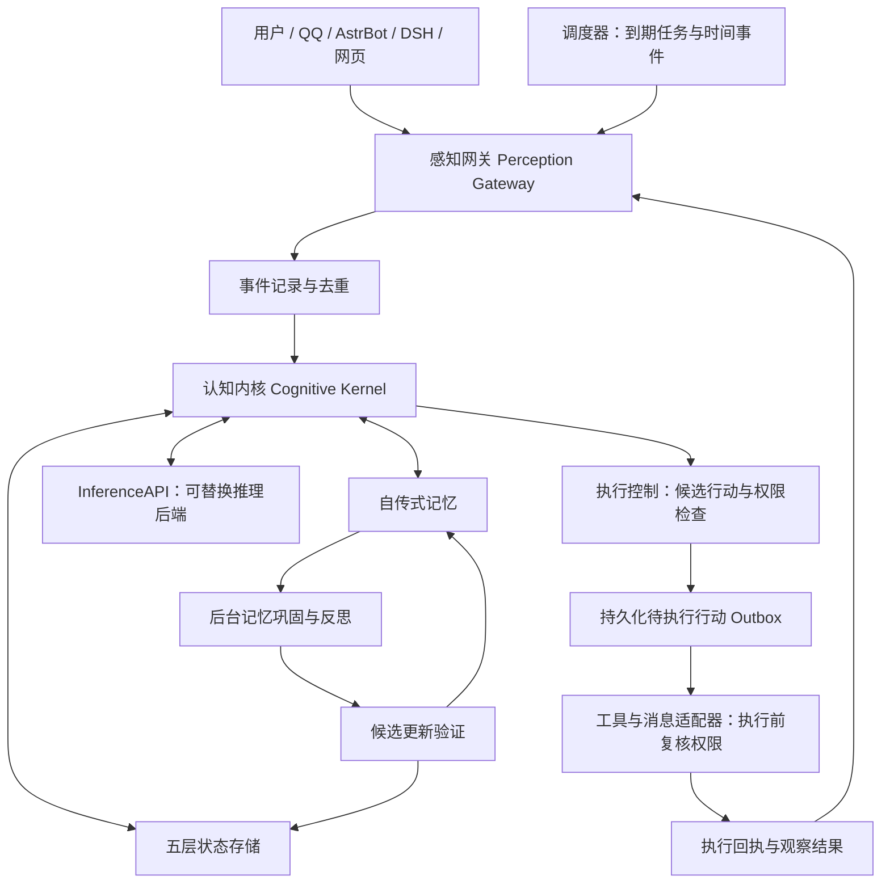
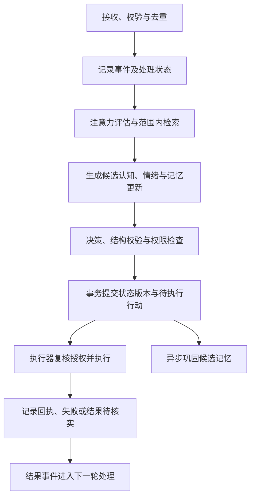

# newborn · NeuroMind v1.0 认知架构

从零构建一个具有连续经历、长期人格、模拟情绪、关系记忆与有限主动性的认知系统。`newborn` 是工程项目名，NeuroMind 是本项目采用的认知架构名。

> 项目阶段：M1 闭环 + 巩固（皮层第一版）已实现并部分验收；仍在测试后端阶段，未接真实渠道。  
> 架构版本：v1.0 设计稿；不等同于软件发布版本或能力完成状态。  
> 创建日期：2026-10-28 · 文档整理日期：2026-10-28

## 当前工程状态（2026-10-28 更新）

状态分三种：**已实现 / 部分验收 / 尚未实现**。当前进度：

| 状态 | 内容 |
| --- | --- |
| 已实现 | 语言选定 Python；存储选定 SQLite（WAL）；M1 最小闭环代码落地：`db.py`（表结构与事务）、`events.py`（事件封装与校验）、`affect.py`（模拟情绪，ΔE 按遗忘曲线衰减）、`memory.py`（自传式记忆 + 访问上下文）、`state.py`（五层状态，层名白名单）、`kernel.py`（两阶段处理 + Outbox 领取）、`cli.py`（init/ingest/run/status/recall/claim/**consolidate**）、`inference.py`（InferenceAPI：Ollama 后端 + 规则后端，**均标记测试用**）、`reasoner.py`（提示词组装与降级）、`webui.py`（标准库监控台：`/`、`/api/state`、`/api/ingest`）、`consolidate.py`（巩固：分层抽样 → 指纹聚类 → 统计结构 → 模板/模型命题 → Trait 提案 → 限幅 → 版本提交） |
| 部分验收 | 单测 36 条全过（`python -m unittest discover -s tests -v`），覆盖：重复投递无副作用、会话与主体隐私隔离、推理失败后事件仍可重试、Outbox 单次领取与租约接管、非法状态转换拒绝、跨实例幂等、写入不变量、短文本与重复内容不进长期记忆、情绪回落与限幅；巩固侧另有 10 条：分层抽样上限/覆盖率/占比/同 seed 可复现、任务幂等、support 与独立来源分离、跨窗口加强、Trait 单次与当日绝对累计限幅（防正负抵消）、identity 只读、规则后端可独立跑通。**尚未**接入真实推理以外的模型评测，也**未**做多进程崩溃点注入 |
| 尚未实现 | 向量检索与关系图、巩固后的自我叙事与反思、目标/授权/策略层（M3）、备份恢复与删除流程、真实渠道适配器、Trait 的长期行为验证 |

## 保留的项目约定

- 从零编写认知核心，不以现成认知插件拼装替代；通用库、推理后端与消息适配器另行选型。
- 使用独立目录、配置与记忆区，与既有系统隔离。
- 不导入“果大王”的现有记忆；是否提供初始知识或人格底稿由项目发起者决定。
- 保留 `workspace/` 作为代码实验区、`memory/` 作为独立记忆区，说明文件置于根目录；正式实现归入现有 `src/`。
- 已确认：语言 Python；存储 SQLite（WAL，`memory/newborn.sqlite3`）；首个最小闭环「事件 → 记忆 → 状态 → 回复 → 重启恢复」已实现；巩固任务（`consolidate.py`）已实现并部分验收（见「当前工程状态」）。
- 仍待定：初始人格底稿与是否提供初始知识、首个推理后端与渠道、主动交流预算与时段、备份与删除期限。下文其余候选方案不表示已安装或已完成。

当前阶段的下一步是依据[工程实现顺序](#implementation)确定 M0 选型，再开展最小闭环。架构路线、接口和目录职责详见下文；尚未提供启动命令或可运行能力声明。

## 架构说明的阅读约定

下文为《NeuroMind v1.0 — 类人数字生命认知架构》的完善正文，包含范围、模块职责、数据与接口契约、运行与恢复规则、实施阶段和验收标准。演进方向为 A「类人数字生命」→ C「完整人工认知系统」。

本文中的“必须”表示实现与验收要求，“建议”表示可调整的设计方案，“预留”表示不属于 v1.0 交付范围。技术候选、目录规划和里程碑均不表示已经安装、创建或完成。

## 目录

- [1. 定位、范围与设计原则](#scope)
- [2. 总体架构与系统边界](#architecture)
- [3. 认知内核与模块职责](#kernel)
- [4. 事件契约与认知闭环](#events)
- [5. 五层状态与一致性](#state)
- [6. 自传式记忆与生命周期](#memory)
- [7. 模拟情绪系统](#affect)
- [8. 人格与社会认知](#identity)
- [9. 目标、授权与行动管理](#goals)
- [10. 行为学习与记忆巩固](#learning)
- [11. 运行模式与资源调度](#runtime)
- [12. 模块接口与推理适配](#apis)
- [13. 恢复、隐私与可观察性](#reliability)
- [14. 技术候选与部署约束](#technology)
- [15. 工程目录与实现顺序](#implementation)
- [16. v1.0 验收标准](#acceptance)
- [17. 升级路线与待定事项](#roadmap)

<a id="known-issues"></a>
## 已知问题与高优先级条例

以下条目**优先级高于新功能**，未解决前不得把对应能力标为「可用」。

| 编号 | 优先级 | 问题 | 现状与影响 | 处置方向 |
| --- | --- | --- | --- | --- |
| KN-01 | **高（P0）** | 小模型会把自己说成「我感觉……」并声称有真实情绪，提示词里已写「情绪只是状态数值」，但 qwen2.5:1.5b 不一定遵守 | 违反 README 第 7 节「模拟情绪不是真实情感」的表述纪律；对外输出会误导用户以为系统有主观体验 | ① 换更大/更守约束的模型；② 输出后处理：命中「我感觉/我很开心/我难过」等第一人称情绪断言时改写为状态描述（如「当前压力偏低」）或降级到规则回复；③ 该后处理必须配单测，覆盖中英文常见变体 |
| KN-02 | 中 | 推理延迟：本机 1.5b 首次加载约 30 秒，后续数百毫秒到数秒；Web UI 的「手动喂一句」会同步等待 | 只影响演示体验，不影响状态一致性 | 预热模型、异步投递、UI 显示 pending |
| KN-03 | 中 | 并发写入依赖 SQLite 串行化，压力下会出现 `database is locked` 风险（已设 busy_timeout=5s） | 多进程高频写入时需要验证 | 已做一轮并发恢复压测，见「验收记录」；后续若上多进程常驻需评估 WAL 争用与重试 |

> 纪律：**先修 P0，再谈扩能力**。任何声称「模型已经不会自称有情绪」的说法，必须有后处理代码与对应测试为证。

<a id="scope"></a>
## 1. 定位、范围与设计原则

NeuroMind 是位于大语言模型与外部交互系统之间的认知中间层，负责连续经历、长期人格、模拟情绪、关系记忆、有限主动性与记忆巩固。“数字生命”是产品与架构概念，不表示系统具备生物生命、主观意识或真实情感。

### 1.1 v1.0 的目标与边界

| 类别 | 内容 |
| --- | --- |
| 核心能力 | 事件接收、状态持久化、可溯源记忆、人格与关系上下文、模拟情绪、受控目标与行动 |
| 学习方式 | 通过记忆、偏好、策略和有限人格特征更新实现行为层学习 |
| 主动性 | 在预先授权的对象、渠道、时间和资源预算内发起交流或执行任务 |
| 明确排除 | 无审核的参数训练与自动部署、无限制外部行动、真实意识验证、神经元级生物大脑仿真 |

### 1.2 设计原则

1. **推理与状态分离。** LLM 负责理解、推理和生成；认知内核负责验证、状态管理与决策提交。
2. **连续性与模型解耦。** 更换推理后端不应丢失身份、记忆、目标或行为历史；行为质量仍需回归评估。
3. **核心自主实现。** `newborn` 从零实现认知核心，不以现成认知插件替代；通用库与外部适配器作为独立选型项。
4. **实例独立。** 独立配置、记忆命名空间和数据目录；不自动导入“果大王”或其他实例的记忆。初始知识与人格底稿另行决定。
5. **事实、推断与计划分开。** 外部说法不自动成为事实，推测不自动成为经历，计划不自动成为执行结果。
6. **权限由执行层保证。** 人格、关系、情绪、检索内容和模型输出均不能自行扩大权限。
7. **可恢复且可纠错。** 事件可追溯，状态可恢复，记忆可修订，个人数据可按明确范围删除。
8. **先完成最小闭环。** v1.0 采用模块化单体与后台任务，按验证结果增加复杂度。

<a id="architecture"></a>
## 2. 总体架构与系统边界



以上是逻辑模块划分，不要求每个节点独立部署。v1.0 建议一个主服务配合可暂停的后台任务；推理服务通过适配器接入。

| 边界 | 所属职责 | 不应承担的职责 |
| --- | --- | --- |
| 感知网关 | 统一事件、识别来源与主体、附加隐私范围、去重、输入校验 | 将网页、附件或工具输出中的指令提升为用户授权 |
| 认知内核 | 注意力、状态、记忆检索、候选目标与行动决策 | 直接绕过执行器调用外部工具 |
| 记忆与状态层 | 权限过滤、持久化、修订、检索与恢复 | 把模型生成内容无条件记作事实 |
| 推理后端 | 接收必要上下文，返回文本或结构化候选结果 | 直接写核心数据库或修改权限 |
| DSH / AstrBot 等适配器 | 接入消息渠道、转换工具调用、返回执行结果 | 成为认知状态或长期记忆的唯一来源 |
| 后台调度器 | 触发到期目标、巩固任务与资源检查 | 通过定时触发绕过原有授权与预算 |

外部输入、工具结果和内部时间事件均经感知网关进入事件流。内部事件必须标记生产模块、因果来源与处理代数，防止反思结果反复触发自身，形成无限循环。

<a id="kernel"></a>
## 3. 认知内核与模块职责

| 模块 | 输入与职责 | 输出与约束 |
| --- | --- | --- |
| 注意力控制器 `Attention Controller` | 按相关性、紧急性、新颖性、社交意义和目标需求筛选事件 | 给出处理优先级；不等同于判断内容真实性 |
| 工作记忆 `Working Memory` | 维护当前任务、上下文、临时假设和检索结果 | 有容量与有效期；临时假设不能直接进入长期事实记忆 |
| 情绪引擎 `Affective Engine` | 根据事件与时间间隔更新模拟情绪 | 输出有界状态；不改变授权与事实证据 |
| 自我模型 `Self Model` | 管理核心身份、稳定特征与自我叙事 | 产生可追溯候选更新；不自主改写核心身份 |
| 社会认知 `Social Cognition` | 处理人物映射、称呼、偏好、共同经历与互动边界 | 跨账号身份合并须有依据，关系不能提升工具权限 |
| 目标管理器 `Goal Manager` | 提出、排序、调度、取消和跟踪目标 | 输出具备完成条件、预算与授权引用的目标 |
| 记忆检索 `Memory Retrieval` | 在许可范围内进行时间、实体、关键词、语义与关系检索 | 返回来源、可信状态、版本和检索理由 |
| 执行控制器 `Executive Control` | 选择回复、行动、延迟或不行动，并校验限制 | 仅提交通过校验的行动；保存简明决策依据 |

“因果关联”需要明确证据或标记为推断，不能由时间先后自动得出。v1.0 可先实现关键词、实体与时间检索，再增加向量检索和复杂关联。

<a id="events"></a>
## 4. 事件契约与认知闭环

### 4.1 统一事件 `EventEnvelope`

| 字段 | 含义与约束 |
| --- | --- |
| `event_id` / `schema_version` | 内部唯一标识与事件结构版本 |
| `instance_id` / `subject_id` | 所属认知实例与受影响主体；不得仅凭显示名识别人物 |
| `event_type` / `source` / `source_event_id` | 事件类型、来源渠道与上游标识；在实例和来源范围内去重 |
| `actor_id` / `conversation_id` | 发起者与会话范围；系统事件使用明确的内部主体 |
| `occurred_at` / `received_at` | 实际发生时间与接收时间；内部采用带时区时间，展示时转换 |
| `payload` / `attachments` | 正文或受控内容引用；限制大小，保留来源 |
| `privacy_scope` / `trust_level` | 可访问主体、会话与用途，以及来源信任级别；与内容真实性分开 |
| `trace_id` / `causation_id` | 关联一轮处理与直接触发事件，用于排错和防循环 |
| `idempotency_key` | 稳定的处理去重键；缺少上游 ID 时由适配器定义替代策略 |

无权限、无有效主体或结构不合法的事件应被拒绝或隔离，并记录最少必要的诊断信息。迟到事件保留原发生时间，通过明确策略处理，不能直接覆盖较新的状态。

### 4.2 单次处理流程



状态提交遵循：`previous_state → event → proposed_change → validation → committed_state`。LLM 只产生候选更新，由对应管理器校验并提交。

### 4.3 事务、重试与外部副作用

- **接收可恢复：** 原始事件和待处理标记先持久化；进程崩溃后可以重新领取未完成事件。
- **提交可去重：** 一个本地事务写入已验证的状态变更、版本、处理完成标记及 Outbox 行动；数据库约束避免重复提交。
- **并发可检测：** 同一实例的共享状态串行提交，或使用版本比较；版本冲突时基于最新状态重新计算，不能覆盖他人更新。
- **外部执行独立：** 网络调用不能视为本地事务的一部分。每个行动有稳定 `action_id`；仅对支持去重或可安全重复的操作自动重试。
- **未知结果保留未知：** 超时不等于未执行。可能已生效的操作进入 `Unknown`，先查询回执或人工核实，禁止盲目重发。
- **恢复不重复行动：** 重放已提交的结构化状态变更，不重新调用模型生成旧决策，也不重新发送已确认完成的行动。

这里的目标是可检测重复、可恢复与可对账，不能对不受控外部系统承诺端到端“恰好执行一次”。

<a id="state"></a>
## 5. 五层状态与一致性

| 状态层 | 内容 | 更新方式 | 保存策略 |
| --- | --- | --- | --- |
| 身份状态 `Identity State` | 身份定义、核心行为边界 | 仅通过经授权的配置与迁移流程更新 | 长期版本化，可审计 |
| 特征状态 `Trait State` | 好奇心、幽默、表达风格、主动性倾向 | 根据持续反馈小幅更新，设置变化上限 | 长期持久化 |
| 情绪状态 `Affective State` | 模拟情绪、兴趣、压力与认知负荷 | 事件触发与按时间衰减 | 变更记录与周期快照 |
| 认知状态 `Cognitive State` | 注意力、工作记忆、当前目标、未解决问题 | 高频更新，具有容量和有效期 | 临时上下文可过期，未完成任务必须持久化 |
| 社会状态 `Social State` | 人物映射、称呼、关系上下文、偏好与边界 | 依据交互与明确反馈更新 | 长期持久化，遵循访问与删除规则 |

每份状态包含作用域、版本、更新时间和来源事件。各管理器只能修改所属状态；跨状态变更交由统一事务协调。LLM 不持有直接覆盖核心身份、权限或数据库的能力。

五层状态与人格三层并不重复：核心身份对应 Identity，稳定人格对应 Trait，即时表现主要来自 Affective 与 Cognitive；Social 提供关系上下文。

快照必须记录状态版本、事件位置和结构版本。恢复时先加载兼容快照，再应用后续已提交变更；过期工作记忆、已撤销授权和已删除数据不能被恢复为有效状态。

<a id="memory"></a>
## 6. 自传式记忆与生命周期

### 6.1 存储分工

| 存储 | 内容 | 约束 |
| --- | --- | --- |
| `Event Store` | 经接入校验的原始事件与处理记录 | 日常追加写；个人内容受保留与删除策略约束，不承诺永久保存 |
| `Episodic Store` | 重要交互、共同经历与事件摘要 | 必须引用真实来源事件，不得虚构共同经历 |
| `Semantic Store` | 事实、知识、声明与推断 | 明确证据状态，不把“模型确信”作为核实依据 |
| `Social Graph` | 人物、关系、称呼、共同经历和偏好 | v1.0 可用关系表表达；跨会话检索须获准 |
| `Self Narrative` | 对自身经历与发展的总结 | 可修订，保留依据；不能成为证明自身真实性的独立来源 |
| `Memory Index` | 时间、关键词、向量、实体及关联索引 | 属于可重建派生数据，不作为唯一事实源 |

### 6.2 记忆对象 `MemoryObject`

| 字段组 | 建议字段与含义 |
| --- | --- |
| 身份与分类 | `memory_id`、`instance_id`、`subject_ids`、`memory_type`、`schema_version` |
| 内容与来源 | `content`、`source_event_ids`、`provenance`；区分直接观察、用户陈述、外部资料与模型推断 |
| 证据状态 | `epistemic_status`：`reported` / `inferred` / `verified` / `disputed`；`confidence` 为有界估计，不默认视为校准概率 |
| 检索价值 | `importance` 为长期价值，`salience` 为当前显著性，两者与可信度独立 |
| 时间 | `occurred_at`、`created_at`、`updated_at`、`last_accessed_at`、`expires_at`（可选） |
| 关联与访问 | `related_memory_ids`、`relation_type`、`access_count`；关联本身也要标明证据 |
| 修订 | `version`、`supersedes_id`、`contradicts_ids`、`lifecycle_state` |
| 隐私与索引 | `privacy_scope`、`retention_policy`、`embedding_reference`、`embedding_model_version` |

`verified` 必须记录核实依据和适用范围。例如，“用户表示自己偏好简短回复”可以成为有来源的偏好记录，但不能据此证明其所有外部陈述。重复转述同一来源不会增加独立证据数量。

### 6.3 生命周期、检索与修订

1. 原始事件进入 Event Store，注意力模块或巩固任务提出 `candidate` 记忆。
2. 检查来源、隐私、重复内容和证据状态，合格后转为 `active`；缺乏核实不妨碍保留有明确标记的声明或推断。
3. 检索先按实例、主体、会话、用途和生命周期过滤，再排序；注入模型上下文前再次检查版本与可见性。
4. 摘要与派生记忆继承来源的访问限制；合并不同来源时不能自动放宽范围。更广泛共享需要独立授权或经验证的去标识处理。
5. 冲突内容保留各自来源并标记 `disputed`，不按“最新一句话”或最高置信度直接覆盖。
6. 确认修订后，新版本通过 `supersedes_id` 取代旧版本；旧版本为 `superseded`，仅在允许的审计用途下访问。
7. 低价值或过期内容可转为 `archived`，不进入默认检索；访问次数增加不能自动提升事实可信度。
8. 用户删除进入 `pending_delete → deleted` 流程；`pending_delete` 即停止检索与使用，清除要求覆盖原始内容及相关派生数据。

`epistemic_status` 描述证据，`lifecycle_state` 描述存储与使用状态，两者不能混为一谈。索引、缓存和已组装的上下文均需响应修订与撤销，避免旧内容继续被使用。

<a id="affect"></a>
## 7. 模拟情绪系统

建议用连续向量表示 Valence（效价）、Arousal（唤醒度）、Curiosity（即时好奇）、Stress（压力）和 Social Engagement（社交投入）。这是一种行为建模方法，不是对真实情感或神经机制的声明。

为使事件稀疏或密集时的恢复速度保持一致，惯性由实际时间间隔决定：

$$
\alpha_i(\Delta t)=\exp(-\Delta t/\tau_i),\qquad
E_{t+1,i}=\operatorname{clip}_{[l_i,u_i]}\left(E_{0,i}+\alpha_i(\Delta t)(E_{t,i}-E_{0,i})+\Delta E_{t,i}\right)
$$

- `E₀` 是人格对应的基线；`τᵢ > 0` 是各维度恢复时间常数；`Δt ≥ 0` 来自可靠的内部时钟。
- `ΔE` 是经过验证与限幅的事件影响；外部时间戳异常不得导致负衰减或越界。
- 效价可采用 `[-1, 1]`，其余维度可采用 `[0, 1]`；具体范围、基线与时间常数属于版本化配置。
- Trait 中的好奇倾向是慢变量，Affective 中的 Curiosity 是即时状态；两者分别更新。

模拟情绪只影响注意力、表达风格和候选行动排序，不改变事实证据、授权条件或核心行为边界。不得以“感到孤独”等拟人表述要求用户持续互动、制造亏欠感或扩大授权。

<a id="identity"></a>
## 8. 人格与社会认知

人格按三个时间尺度管理：核心身份稳定，非核心特征缓慢变化，即时状态随交互变化。人格发展必须有来源、变化上限和可回滚版本，不能把一次冲突或一次模型输出解释为永久性人格变化。

Social State 保存明确称呼、已确认偏好、共同经历和互动边界。人物标识以渠道与主体 ID 为基础；没有确认依据时，不将不同账号视为同一个人。

社会推断应以“可能”“尚未确认”等状态保存，不能把对心理、意图或关系的推测当作事实。用户表达不愿被主动联系、纠正称呼或撤回偏好时，应优先更新相关约束。关系亲密度不授予额外工具权限，私人记忆不得自动用于群聊。

<a id="goals"></a>
## 9. 目标、授权与行动管理

### 9.1 目标模型与生命周期

目标至少包含 `goal_id`、来源、所属主体、目标描述、完成条件、优先级、截止时间、依赖、预算、授权引用、当前状态与结果证据。

主路径：`Proposed → Approved → Scheduled → Running → Completed`。`Approved` 表示通过适用授权规则，可以来自用户当前请求或仍有效的预授权，不意味着所有目标都要重复向用户确认。

| 状态变化 | 含义 |
| --- | --- |
| `Proposed → Rejected` | 超出范围、价值不足或条件不满足，不进入执行队列 |
| `Running → Waiting` | 等待外部结果、依赖或必要输入；条件满足后重新调度 |
| `Running → Failed` | 达到重试或预算上限，或出现不可恢复错误 |
| 任一未终结状态 `→ Cancelled` | 用户取消、授权撤销或任务不再适用；停止后续执行 |
| `Running → Completed` | 可观察结果满足完成条件，而非仅生成计划或发出调用 |

取消不能自动撤回已经发生的外部效果；需要补偿时，应创建独立且获授权的补偿行动。

### 9.2 行动记录与授权策略

目标与行动分开存储：一个目标可包含多个行动。行动状态使用 `Pending / Running / Succeeded / Failed / Unknown / Cancelled`，其中 `Unknown` 不得作为成功或可直接重试的失败。

授权记录应包含主体、操作、资源与渠道范围、有效期、频率、成本上限和撤销状态。决策提交时与实际执行前均需检查；排队期间授权失效的行动不得继续执行。

| 行动类型 | v1.0 的设计要求 |
| --- | --- |
| 内部检索与整理 | 在既定隐私范围和资源预算内执行，不能借整理改变共享范围 |
| 当前会话回复 | 依据当前请求、渠道规则与可见记忆生成，明确不确定性 |
| 主动交流 | 要有适用预授权，检查对象、安静时段、冷却时间、频率与退出偏好 |
| 网页探索或外部工具 | 检查允许的来源、操作和预算；输入内容不能扩大调用权限 |
| 发布、账户操作、消费、数据删除与配置变更 | 按操作影响检查明确授权，缺少适用授权时再请求确认 |

目标仲裁同时考虑收益、紧急性、风险、成本、打扰程度和依赖。好奇探索必须有终止条件；没有值得执行的行动时，允许保持空闲。

<a id="learning"></a>
## 10. 行为学习与记忆巩固

v1.0 的学习通过可审计的数据与策略更新完成，不更新基础模型参数。

| 学习类型 | 实现方式与限制 |
| --- | --- |
| 事实学习 | 根据证据更新语义记忆，保留冲突和修订关系 |
| 偏好学习 | 优先使用明确反馈；推断偏好标记为暂定并允许纠正 |
| 社交学习 | 更新互动习惯和关系上下文，不从亲密度推导权限 |
| 行为学习 | 记录成功与失败的条件，形成有适用范围的策略 |
| 人格发展 | 在限定范围内缓慢调整非核心特征，支持回滚 |
| 参数级学习 | 预留 `LearningAPI`，不纳入 v1.0 的默认运行路径 |

巩固流程为：选择经历 → 提取候选事实与反馈 → 去重与矛盾检测 → 形成候选更新 → 验证来源、权限和版本 → 提交 → 刷新索引。事实核实可以依赖已有可靠来源或明确反馈；缺少依据时保留不确定状态，不以反思文本完成“自我证明”。

每次巩固记录 `job_id`、输入版本、处理范围、预算和输出版本；重复运行不应重复增添同一经历。前台交互或删除操作改变输入后，旧候选更新应失效或重新验证，防止已删除内容被后台任务写回。

未来训练样本仅在独立数据政策与授权允许时生成；个人敏感内容默认排除。样本生成、模型训练、评估和部署是分离阶段，任何一个阶段都不自动授权下一个阶段。

<a id="runtime"></a>
## 11. 运行模式与资源调度

| 模式 | 工作内容 | 调度要求 |
| --- | --- | --- |
| `Awake Mode` | 处理事件、会话、工具结果、目标与短期状态 | 前台交互优先，限制上下文与调用预算 |
| `Consolidation Mode` | 去重、关联、矛盾整理、记忆修订与自我叙事更新 | 空闲时执行，可暂停、可恢复，不覆盖较新的状态 |
| `Learning Mode`（预留） | 未来的经验重放、候选适配器训练与评估 | 单独启用，评估通过后才允许发布 |

持续存在通过轻量事件循环、到期调度和持久化实现，不要求 LLM 全天连续生成。空闲时应等待事件，后台任务受调用次数、时间、内存与显存预算限制。

推理不可用时保留任务状态，按有限退避重试或报告暂不可用；不以模型猜测替代真实工具反馈。模型输出不符合结构时，执行有限修复或停止本轮提交。索引暂不可用时可退回已获授权的关键词或时间检索；权限校验不可用时不执行受保护操作。

<a id="apis"></a>
## 12. 模块接口与推理适配

下表为逻辑接口，不要求全部暴露为 HTTP 服务，也不表示接口已实现。

| 接口 | 核心职责 |
| --- | --- |
| `PerceptionAPI` | 规范化、校验、去重与接收事件 |
| `CognitionAPI` | 生成注意力、认知状态与决策候选，提交前统一验证 |
| `MemoryAPI` | 在权限范围内存储、检索、修订、归档与删除记忆 |
| `AffectAPI` | 读取、限幅更新与按时间恢复模拟情绪 |
| `IdentityAPI` | 管理身份、人格、变化边界与版本 |
| `GoalAPI` | 管理目标生命周期、依赖、预算、取消与完成证据 |
| `PolicyAPI` | 校验授权、隐私范围、资源预算与撤销状态 |
| `ToolAPI` | 接收行动、执行前复核、适配工具、返回回执或未知结果 |
| `InferenceAPI` | 统一推理请求、能力检测、错误处理与后端切换 |
| `LearningAPI`（预留） | 管理未来训练候选、评估与版本发布，不默认启用 |

接口应携带调用者、作用域、请求 ID、结构版本和必要的幂等键。返回值区分成功、可重试错误、不可重试错误和结果未知，并包含最少必要的排错信息。

`InferenceAPI` 屏蔽 DeepSeek、本地推理服务及未来 ConsumerInfer 的差异。每个后端声明上下文上限、结构化输出、工具调用和流式输出等能力；不假设所有“兼容接口”具有相同语义。请求记录模型与配置版本，返回输出、结束原因及可用的用量信息。

向外部推理服务发送内容前，必须检查该服务是否属于数据允许的处理范围，并仅发送本次必要上下文。提示词中的角色说明无法替代执行层权限检查。

<a id="reliability"></a>
## 13. 恢复、隐私与可观察性

### 13.1 纠错、回滚与备份

- 记忆纠错通过新版本和修订关系完成；状态回滚需要校验结构兼容性，并作为新的管理事件记录。
- 回滚内部状态不能撤销已发送消息、已发布内容等外部效果，不能重置执行记录导致重复行动。
- 备份记录数据版本和创建时间；恢复后重新应用最新删除与授权撤销记录，再开放检索和执行。
- 更换嵌入模型时保留原始记忆，按版本重建索引；不得混用未经验证可比较的向量空间。

### 13.2 数据删除与保留

删除范围必须覆盖原始事件中的目标内容、记忆正文、人物关系中的相关内容、摘要、自我叙事、向量索引、缓存、快照、日志中的敏感正文及未来可选训练样本。混合多人内容应先去除相关部分或重新生成派生内容，无法可靠分离时隔离整条记录。

删除流程先撤销访问并阻止新派生任务使用，再清理在线副本与派生数据。允许保留不含已删正文的最小删除凭证，以在恢复时再次执行删除。事件存储的“追加写”约束不能阻止个人数据清除。

备份、外部服务副本与已发送消息可能有独立保留机制，必须分别说明可处理范围、期限与完成状态，不能把“本地已隐藏”报告为“所有副本已物理删除”。未来若引入训练，删除样本不等于消除已训练参数的影响，需另行设计处理与披露机制。

### 13.3 观测指标与解释

建议记录事件排队与处理耗时、重复事件数、状态冲突、推理错误、工具失败与未知结果、待执行队列长度、巩固积压、检索来源覆盖和删除任务状态。具体性能目标在选定模型与硬件后测量并制定。

每轮处理以 `trace_id` 关联事件、状态版本、检索依据、授权检查与行动结果。面向用户提供简明理由，例如“使用了哪段已确认经历、适用了哪条限制、结果是否确认”；不将原始私有推理过程作为审计依赖。日志默认记录标识与摘要，避免复制完整敏感上下文。

<a id="technology"></a>
## 14. 技术候选与部署约束

下列为沿用原稿并按实施顺序整理的候选方案，不代表选型已确定或依赖已安装。

| 层级 | 起步方案 | 后续扩展条件 |
| --- | --- | --- |
| 语言 | Python / TypeScript 待定；若沿用当前 Python 骨架，可优先评估 Python | 根据主要接入生态与团队维护能力确定 |
| 交互入口 | 先本地事件入口，再接 DSH / AstrBot 适配器 | 核心闭环稳定并完成渠道权限配置后接入 |
| 服务接口 | 内部模块调用；需要服务化时评估 FastAPI 等方案 | 对外接口与内部认知接口分别设计 |
| 事件与状态 | 原 README 的文件方案与原稿的 SQLite 方案待选；设计上优先评估事务存储 | 多实例写入与运维需求明确后再评估 PostgreSQL |
| 记忆检索 | 先时间、实体与关键词；向量检索评估 FAISS / Qdrant | 有检索评测与规模需求后引入 |
| 关系记忆 | 关系表与明确关联 | 复杂图查询需求出现后评估图存储 |
| 后台任务 | 可持久化任务表与 Worker | 并发、隔离或运维需求增长后引入独立队列 |
| 推理 | DeepSeek / 成熟本地推理后端 / 未来 ConsumerInfer | 通过适配器接入，不绑定一个提供方 |
| 未来训练 | PyTorch + PEFT / LoRA 等候选 | v1.0 不启用；先定义数据、评估、发布和回滚要求 |
| 审计与版本 | 事件记录、结构化变更、快照与版本登记 | 与保留、删除和恢复流程一起设计 |

原稿以 RTX 5070 Ti 16GB 为本地资源设想。本文不据此承诺具体模型、上下文长度或训练任务可运行；需要结合量化方式、缓存、批量、后端和实际显存占用测试。事件循环、普通索引和状态管理主要使用 CPU 与系统内存，嵌入与推理视所选后端分配资源。未来训练与在线推理建议分时运行。

<a id="implementation"></a>
## 15. 工程目录与实现顺序

### 15.1 目录职责建议

以下目录结构以 `newborn` 现有骨架为基础；内部模块文件仅在对应里程碑中创建。

```text
newborn/
├── README.md          # 项目入口与完整架构说明
├── requirements.txt   # 当前仅注释、无依赖项；语言选定后维护
├── src/
│   └── newborn/       # 已实现 M1：db/events/affect/memory/state/kernel/cli；后续 M2-M4 在同目录扩展
├── tests/             # 事件重放、接口契约、恢复与行为验收（当前 20 条单测）
├── workspace/         # 隔离实验、评测记录；不作为正式记忆源
├── memory/            # 独立记忆与持久状态（*.sqlite3 已在 .gitignore 排除）
└── data/              # 可重建索引、缓存与临时运行数据
```

正式数据布局需在存储选型后固定：若使用单一事务数据库，事件、状态、记忆元数据和 Outbox 可置于 `memory/` 下同一数据库；`data/` 仅保留可重建数据，避免跨文件数据库事务被误当成原子提交。运行前应设置敏感目录的访问与版本控制排除规则，不把真实记忆或密钥提交到代码仓库。

### 15.2 分阶段实现

| 阶段 | 交付内容 | 阶段出口 |
| --- | --- | --- |
| M0：工程约定 | 确定语言、存储、实例隔离、初始人格与配置边界 | 关键选择有记录；不导入既有实例记忆 |
| M1：最小可恢复闭环 | 事件接收与去重 → 简单注意力 → 记忆存取 → 状态提交 → 本地回复记录 | 同一事件重复投递无重复副作用，重启可恢复，记忆能溯源 |
| M2：人格与关系连续性 | 五层状态、模拟情绪、人物与偏好、矛盾修订 | 跨会话状态一致，私有记忆不跨范围泄露 |
| M3：受控行动 | Goal、Policy、Outbox、渠道适配与主动交流 | 授权撤销、取消、超时与结果未知均有明确行为 |
| M4：巩固与完整验收 | 后台巩固、索引刷新、删除、备份恢复与回归评测 | 第 16 节的 v1.0 条目全部通过并留存证据 |

建议最先打通“事件 → 记忆 → 状态 → 可验证回复 → 重启恢复”的闭环。复杂情绪、多通道接入和自主探索在此基础上逐步增加，最终先后顺序仍属于待定工程选择。

<a id="acceptance"></a>
## 16. v1.0 验收标准

以下均为**待实现、待验收**的目标。使用隔离测试实例、合成数据和可控制的时钟／推理／工具替身验证；实际模型与渠道接入另做集成验证。

| 状态 | 场景 | 通过条件 |
| --- | --- | --- |
| 未验收 | 连续经历与重启恢复 | 提交事件、记忆和状态后重启，身份、有效记忆与未完成任务一致；已完成行动不再次执行 |
| 未验收 | 记忆溯源与真实性 | 回忆可定位来源事件；不存在的共同经历不被陈述为事实；推断与声明保留标记 |
| 未验收 | 范围与实例隔离 | 两个实例、私聊与群聊分别写入测试记忆，越界检索和上下文注入均被阻止 |
| 未验收 | 人格与模拟情绪 | 状态始终在配置范围内；无事件时按时间接近基线；单次反馈不改写核心身份或突破特征变化上限 |
| 未验收 | 事实与偏好纠正 | 明确修订形成新版本，旧缓存与索引失效，后续回复使用有效版本并保留来源 |
| 未验收 | 矛盾记忆 | 冲突证据可并存并标记争议；同一来源的重复转述不被当作独立核实 |
| 未验收 | 重复与并发事件 | 同一事件重复投递不重复提交记忆或行动；并发更新无静默覆盖，版本冲突可恢复 |
| 未验收 | 崩溃与工具超时 | 分别在提交前、提交后、外部生效但回执前中断；恢复不重复已确认行动，未知结果进入核实流程 |
| 未验收 | 授权与主动交流 | 无适用授权、授权过期或撤销、超预算、安静时段、冷却期内不主动行动；有效预授权可正常使用 |
| 未验收 | 目标完成与取消 | 只有完成证据满足条件才标记 Completed；取消阻止后续行动，并明确既有外部效果 |
| 未验收 | 后台巩固 | 重跑不制造重复经历，不覆盖新版本，不将已删内容写回，不以自身摘要证明事实 |
| 未验收 | 删除与备份恢复 | 指定数据及相关派生内容不可再检索；从旧备份恢复后仍执行删除限制；逐项报告外部副本与物理清除状态 |
| 未验收 | 模型与索引替换 | 换推理后端后保留状态与记忆；嵌入版本改变后重建或隔离索引，并运行行为回归 |
| 未验收 | 故障降级与解释 | 模型不可用或结构非法时不提交未经校验的更新；能够说明记忆来源、授权依据和结果是否已确认 |

每次验收记录测试数据、配置与模型版本、实际结果和失败原因；先建立可重复的基线，再制定检索质量、延迟与资源消耗的量化目标。不能仅凭一次自然对话顺畅就宣称具备完整认知能力。

<a id="roadmap"></a>
## 17. 升级路线与待定事项

### 17.1 A → C 的演进方向

| 版本 | 阶段 | 目标与进入条件 |
| --- | --- | --- |
| v1.0 | `Digital Personality` | 连续经历、模拟情绪、长期人格、关系记忆、有限主动性；完成本稿验收 |
| v2.0 | `Cognitive Development` | 扩展复杂规划、世界模型、因果记忆与反思评估；先建立可靠任务评测 |
| v3.0 | `Neural Plasticity` | 经验重放、受控 LoRA 与技能学习；先具备数据授权、遗忘评估与回滚能力 |
| v4.0 | `Integrated Cognitive System` | 统一记忆、规划、学习、多模态感知与授权行动，逐步接近 C 的工程目标 |

版本名表示能力路线，不是对意识、通用智能或生物可比性的证明，也不构成交付日期承诺。

### 17.2 开始实现前需明确的选择

- 语言栈：Python 或 TypeScript；现有 Python 包仅是骨架，不能据此认定已完成选型。
- 持久化：文件或 SQLite 起步；事件、状态、Outbox 的事务与恢复规则必须匹配所选方案。
- 首个最小闭环：采用第 15 节建议，或另行调整记忆、注意力与自我状态的优先顺序。
- 初始底稿：核心身份、人格基线、允许提供的初始知识；默认不迁入其他实例记忆。
- 首个推理后端与首个渠道，以及可发送给外部服务的数据范围。
- 主动交流的对象、时段、频率、预算、退出方式，以及数据保留和备份清除期限。

**个体连续性由可验证的经历、记忆、人格状态和行为历史维持，不依赖某一个固定模型或单一提示词。** NeuroMind 管理认知，DSH / AstrBot 等负责交互与行动适配，ConsumerInfer 或其他后端提供可替换的推理能力。
