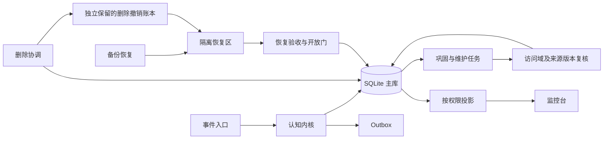

# newborn 下一步计划与可实施框架

日期：2026-10-29（Australia/Sydney）  
项目：`D:\DeepSeekHarness\newborn`  
核心源码：`src/newborn`  
基线：`e3d2e93450e04d887e61525959224bba1cfa7a75`  
文档性质：开发路线、模块设计和验收方案。本次只新增本文，不编写实现代码。

## 1. 阶段判断与推荐顺序

当前已经具备“可持久化的认知闭环”和第一版规则巩固系统。下一阶段的目标是把它变成**能够安全保存真实经历、可恢复、可删除、可解释，并能用评测证明记忆质量的系统**。

建议按以下顺序推进：

**基线与回归门 → 备份恢复 → 删除与派生一致性 → 巩固观测和受控调度 → 记忆质量 → 行为证据与 Trait → 授权渠道。**

先做一个纵向场景：投入合成经历，完成巩固，在监控台看到来源；删除其中一条经历，派生记录随之隔离或重算；恢复删除前的备份后，已删内容仍不可检索。这条场景能把目前最重要的缺口串起来。

工程继续采用 Python、SQLite WAL、CLI、规则后端和现有 Web UI。新增职责先落实为小模块与明确的数据契约，保留现有事件入口和短事务边界。

## 2. 基线：哪些已经完成，哪些需要下一阶段验收

本次核对了本地 HEAD、远端配置、文件清单、测试定义、修复文档和关键代码路径；没有联网核验远端分支，也没有重跑测试或重新执行安全扫描。

| 项目 | 当前依据 | 后续处理 |
| --- | --- | --- |
| 仓库 | 本地 HEAD 为 `e3d2e93`，origin 指向 `Only-Mortal/dsh-brain`；核对前工作树干净，Git 跟踪文件 27 个 | 建立可复查的基线记录 |
| 事件闭环 | 事件先提交，再推理，记忆/状态/Outbox 短事务提交 | 保留，并验证重叠处理和进程崩溃 |
| 记忆隐私 | 强制访问上下文；巩固成员及持久化匹配已有访问域分区 | 作为现有控制维护，新增路径复用相同规则 |
| 皮层第一版 | 分层抽样、指纹聚类、统计命题、语义版本、Trait 限幅，规则路径可运行 | 增加来源一致性、质量评测和可观察性 |
| 两轮修复 | 用户及修复文档报告第一轮 14 条已处理、第二轮 4 条已处置 | 保留处置记录，以完整路径回归证明持续有效 |
| 测试 | 源码中可数到 64 个测试方法；用户及修复文档报告 64 条通过、并发压测通过 | 本文引用既有结果，不将其写成本轮新测试结果 |
| 删除、备份、进程崩溃注入 | 尚未形成完整流程 | 本计划前半段的核心交付 |
| Trait、否定理解 | Trait 为数据覆盖度代理；否定规则有明确边界 | 分别引入行为证据与保守解释策略 |
| 巩固监控 | CLI 已有结果，Web 尚未接入任务解释链 | 先提供只读状态，再增加受控触发 |

README 和旧审计文档的阶段、测试数字及已实现描述存在历史漂移。开始新实现前统一一张“已实现 / 已验收 / 待验收”表；旧文档保留日期和对应提交，不再作为最新能力列表。

### 2.1 首个工作包必须包含的核验项

这部分是下一阶段的回归门，不是沿用上一版本的漏洞结论：

| 核验项 | 当前源码依据 | 必须证明的行为 |
| --- | --- | --- |
| 跨域矛盾更新 | `consolidate.py` 已隔离聚类及持久化匹配，但主流程跨簇矛盾循环仍遍历全部 `prepared`；本次阅读未见循环内的域相等判断 | 两个不同主体/会话的相反陈述，不能互相改写可信状态；补完整流程测试后再关闭此核验项 |
| 实时与恢复重叠 | `process_event` 与 `process_pending` 的领取、处理、提交路径不同 | 同一事件只有一个有效结果；旧领取者不能覆盖新领取者 |
| 状态并发合并 | 情绪在推理前读取，后续保存整个快照；`state.put` 有期望版本参数 | 多个成功事件的增量都保留，期望版本由数据库条件更新原子执行 |
| 升级保真 | 表重建与附加列补齐分开进行；旧 clusters 新增域列有默认值 | 已有语义扩展字段、索引、版本链和访问域不丢失；历史簇不能因默认域被错误归类 |
| 证据与版本身份 | 证据指纹依赖首个产物；普通 `revise` 对新行版本加一 | 换 seed 不重复学习；普通修订为连续版本；去重不抹掉别人的独立经历 |
| 完整 Web 使用路径 | `--token`、Origin/Host 和 JSON 类型检查已加入 | 页面、API、身份及实例选择能一起工作；不能只证明参数字符串存在 |

若核验失败，先修对应最小问题，再进入依赖它的阶段。尤其“第二轮已处置”与“后续任何调用路径都已验证”应分别记录。

## 3. 总体实施框架

### 3.1 四条协作链路

| 链路 | 组成 | 负责的承诺 |
| --- | --- | --- |
| 在线认知 | 接收 → 领取 → 上下文 → 推理 → 校验 → 提交 → Outbox | 输入持久、提交唯一、状态一致、推理不长期占写锁 |
| 记忆维护 | 抽样 → 分域 → 候选 → 来源复核 → 语义/状态提交 | 可追溯、同域、输入变化后候选失效 |
| 数据维护 | 备份 → 隔离恢复；删除 → 撤权 → 派生清理 → 重建 | 能恢复有效数据，恢复后不复活已删内容 |
| 运维观测 | 任务记录 → 指标/解释投影 → 管理员界面 | 能解释任务结果，不通过日志或页面复制私有正文 |

### 3.2 模块边界

下表是拟议职责，不表示文件已经存在。路径相对仓库根目录。

| 位置 | 现有/拟议 | 职责与边界 |
| --- | --- | --- |
| `src/newborn/kernel.py` | 现有，扩展 | 统一事件领取、处理与提交；不把备份、清理和调度塞入事件事务 |
| `src/newborn/memory.py` | 现有，扩展 | 带上下文的读写、修订、归档；所有检索执行生命周期和删除约束 |
| `src/newborn/consolidate.py` | 现有，扩展 | 保留算法；拆清“读取快照/计算候选/复核提交”的职责 |
| `src/newborn/db.py` | 现有，扩展 | 模式升级、约束、索引、短事务；升级必须保真且可中断恢复 |
| `src/newborn/access.py` | 拟议，按需抽取 | 统一访问域及可见性规则，供检索、派生、管理投影共同使用；先复用已有函数，避免两套实现漂移 |
| `src/newborn/jobs.py` | 拟议 | 持久任务状态、领取、租约、幂等、取消和有限重试；先服务维护任务，不引入通用工作流平台 |
| `src/newborn/backup.py` | 拟议 | 一致快照、清单、校验、隔离恢复和恢复门 |
| `src/newborn/retention.py` | 拟议 | 删除请求、依赖遍历、访问撤销、清理与归档政策 |
| `src/newborn/observability.py` | 拟议，按复杂度决定 | 指标与任务解释的安全投影；小规模时可先作为现有模块内的独立职责 |
| `src/newborn/feedback.py` | 后续拟议 | 显式纠错、行为结果和反馈证据；为 Trait 提供独立于数据覆盖度的来源 |
| `src/newborn/cli.py`、`webui.py` | 现有，扩展 | 调用同一服务层；CLI 与 Web 不各自实现删除、恢复或权限逻辑 |
| `tests/fixtures/`、`tests/evals/` | 拟议 | 合成旧库、故障场景、人工标注样例和固定评测集；禁止提交真实记忆 |

### 3.3 全程保持的契约

1. 所有对象绑定 `instance_id`；访问域键的含义与版本明确，查询不能只比较脱离实例的域字符串。
2. 主体“被提及”、记忆“归属者”和“允许读者”分别定义；不能从文本提及或亲密度授予读取权限。
3. 派生对象的允许读者不超过任何来源允许的范围；拒绝权限扩大，缺少域信息时隔离待核验。
4. 推理读取快照；提交复核领取权、来源版本、删除状态和策略版本；模型调用留在写事务外。
5. 模型措辞与规范事实分开；支持数、置信状态、Trait 和执行权限由确定性规则及证据决定。
6. 任务重试可以重复计算，但不能重复产生同一有效业务结果；操作幂等与外部发送幂等分别定义。
7. 内部审计保留标识、版本和最小理由，不复制完整私有提示词或所谓思维过程。

## 4. 阶段 A：可靠性基线与备份恢复

**目标：在保存真实长期经历前，证明数据能保真升级、进程中断可恢复、快照可还原。**

### 4.1 统一领取和提交

- 实时入口和恢复入口共用一次领取机制，每次领取获得新的 `claim_generation` 或等价 fencing token。
- 提交必须验证当前代次、事件状态和租约有效性；旧 worker 晚返回不能提交、结案或释放新 worker 的租约。
- Outbox 的稳定业务标识由事件、行动种类和目标等真实语义确定，数据库约束作为最终防线。
- 状态采用“事务内读取最新值并合并增量”，或带版本谓词的原子条件更新；不能仅在更新前查询版本。
- 恢复批次的领取、续租和预算与实际处理时间匹配。等待慢推理时，不让后续尚未执行的任务一直占有快到期租约。
- 进程仍可先按单 worker 运行；并发能力以故障验收结果逐步开放。

### 4.2 一致快照与备份清单

采用 SQLite 的一致备份能力，避免把运行中主文件与不匹配的 WAL 随意组合。首版提供本地、操作员显式发起的备份。

备份清单至少包含：备份 ID、UTC 创建时间、代码修订、schema 版本、算法版本、实例范围、数据文件校验值、来源水位、删除/撤销账本水位和格式版本。保留期限、位置和副本数量由配置明确，不能默认永久保留。

备份目录位于运行数据区之外且不入 Git；文件访问沿用受保护数据的权限要求。首版如仅依赖宿主磁盘保护，应明确标记“应用未提供独立加密”。备份不能包含令牌或推理服务凭据。

### 4.3 恢复必须先隔离

恢复顺序：校验清单及文件 → 恢复到新目录 → 检查数据库完整性和 schema → 必要升级 → 应用最新删除/撤销账本 → 处理过期任务及未知发送结果 → 业务不变量检查 → 人工确认目标后切换。

切换前保留原库；旧库回退同样必须重新应用最新撤销记录。恢复不能回滚隐私撤销，也不能把已经发送或结果未知的 Outbox 简单变回 pending。

建议首版设计目标：手动备份场景的 RPO 等于最近一次成功备份以来的新增数据；RTO 先在合成规模上测量。自动周期和容量目标在有基线后配置，不预设未经测量的分钟数。

**退出门：**新库与支持的旧库均可备份/恢复；扩展列、索引及访问域保真；损坏清单被拒绝；升级或切换中断后可保留原库；重复恢复不会重复投递行动。

## 5. 阶段 B：删除、保留与派生一致性

**目标：用户能撤回经历，系统能够停止使用、清理派生，并在恢复旧备份后继续遵守撤回。**

### 5.1 首版删除范围

首版支持明确对象 ID、完整会话和完整实例的删除请求。按人物语义删除需要先定义归属与提及关系，作为后续范围；不能把 `subject_ids` 当作人物内容的完整清单。

状态建议：请求已登记 → 访问已撤销 → 正在清理 → 在线副本已清理 → 副本处置完成。失败、待重试和需要人工处理分别记录。接口返回各范围的状态，不能用一个 completed 同时代表“不可检索”和“磁盘介质已不可恢复”。

### 5.2 删除协调流程

1. 校验操作员权限与选择器，先生成影响预览，绑定目标版本与稳定请求 ID。
2. 将最小删除指令写入独立于待恢复快照保存的撤销账本，并确保其持久化；失败时不宣称撤销完成。
3. 在主库提交逻辑撤权，增加对应实例的隐私代次，阻止检索、后台使用及待发行动继续访问。
4. 遍历来源与派生关系：原始事件、情景、语义历代、簇、统计产物、Trait 证据、状态引用、任务产物及日志/缓存。
5. 来源混合的派生先隔离，再使用仍获授权的来源重算；无法可靠分离时维持隔离并给出原因。
6. 清除在线正文与不再允许保留的元数据；重新计算受影响状态；核验无可达残留。
7. 记录在线完成、备份到期/销毁及已发送外部副本的可处理范围；失败保留重试位置。

撤销账本仅保留必要的对象/作用域标识、代次、时间和处理状态，不含已删正文；这些标识仍是敏感元数据，不能因“不含正文”而公开。账本需要独立持久副本及完整性检查；账本不可用或是否最新不确定时，恢复区保持关闭。

账本与主库的双写采用“先持久撤销指令、再更新主库、崩溃后幂等重放”的顺序。必须通过故障注入验证每个中断点；不能假设两个文件天然原子提交。

### 5.3 删除与后台任务的竞争

新增 `privacy_epoch` 或等价撤销版本。后台任务保存输入对象版本及启动时的代次；提交事务内重新读取并比较。代次变化可先保守拒绝整轮候选，再重新抽样；后续有性能证据后再细化到对象级校验。

校验和提交必须在同一事务边界内。仅在计算前检查删除状态，不能防止计算期间撤权。

### 5.4 Trait、情绪与历史状态也属于派生数据

删除来源后只清 memory 正文还不够。Trait 提案需要可追溯到实际来源事件，情绪脉冲需要来源标识，认知工作集和任务结果中的引用也要清理。

对于累计状态，优先从经过验证的检查点和仍允许的证据重放。由于限幅、顺序和衰减会改变结果，不能简单减去当初 delta 后宣称准确撤销。无法重建的维度标为待校准/隔离，阻止继续作为可靠个体结论使用。

### 5.5 逻辑删除与物理清理的边界

`pending_delete/deleted` 首先代表逻辑状态。SQLite 空闲页、WAL、备份及外部副本需要单独处置；物理清理应在适当维护窗口验证。SSD、宿主快照或远端副本的不可恢复删除，不能仅凭应用删除记录或 VACUUM 作保证。

**退出门：**撤权后前台与后台立即不可用；删除过程可重试；任务不写回撤销来源；旧备份恢复不复活内容；来源混合派生不遗留正文；在线和副本状态分别可见；敏感数据不进入 Git。

## 6. 阶段 C：巩固监控与受控后台执行

**目标：先看清楚每轮发生了什么，再允许系统按预算持续运行。**

### 6.1 先实现只读任务视图

第一版监控台展示任务 ID、实例、时间窗、seed、算法版本、输入水位、抽样日/会话分布、访问域数量、候选/提交数量、语义版本变化、Trait 提案接受/拒绝理由、耗时和错误摘要。

任务详情沿“任务 → 产物 → 来源标识 → 版本链”展开。统计概览默认不带原文；获授权查看来源时重新校验上下文。`display_text` 也可能包含敏感信息，不能当成天然脱敏文本。

当前 private/conversation 的规范样本已隐藏。监控投影与内部获授权使用应分开定义；需要增强记忆语义时使用同域的结构化证据表示，不能为了界面便利重新暴露受限样本。

### 6.2 再增加异步触发

管理端提交巩固请求后立即返回任务 ID，页面轮询状态。请求必须绑定实例、权限、预算和幂等键；CLI 与 Web 共用任务服务。首版按实例串行维护任务，前台交互优先，模型展示失败可以降级模板。

任务生命周期建议：pending → running → succeeded；可重试错误进入 retry_wait；另有 failed、cancelled、stale。任务状态与认知事件状态分别建模，避免直接把已有 events 表枚举扩大成所有后台任务的混合状态。

阶段性任务契约：任务类型、实例/范围、请求 ID、参数摘要、输入快照、预算、领取代次、租约、尝试次数、重试时间、阶段检查点、输出引用和非正文错误码。

先建立轻量调度循环：等待到期任务 → 领取 → 检查预算和撤销 → 执行 → 短事务提交 → 等待。周期、安静时段、单日上限、失败退避和暂停入口均可配置。

**退出门：**一次慢巩固不阻塞页面和事件接收；重复点击只形成一次有效任务；重启可看到进行中任务并正确接管；没有符合条件的任务时等待；监控原文授权与普通检索一致。

## 7. 阶段 D：可衡量的记忆质量

**目标：让巩固产物具有正确含义，让当前问题能检索到相关、获授权、仍有效的经历。**

### 7.1 建立固定评测集

先建立约 100—200 条合成、人工标注的最小数据集，规模是实施建议，不是已有成果。覆盖不同主体/会话、重复独立经历、数字变化、直接否定、引述、反问、反讽、同主体真冲突、不同人偏好、来源撤销和跨窗采样。

划分用于规则调整的开发集与固定验收集，按表达模板或场景分组，避免同一句式换数字就同时进入两边。保存数据版本和标签说明。首轮记录基线，再约定质量提升目标；安全与删除相关违规数必须为零。

### 7.2 三个算法边界先讲清

| 边界 | 实施方式 | 验收重点 |
| --- | --- | --- |
| 主题相似不等于事实相同 | 指纹仅辅助找候选；人物、数字、时间、归属、极性与来源分别保留 | 不把“金额100”和“金额1000”当成同一事实证据 |
| 否定规则不等于理解引述和反讽 | 为命题增加解释状态及主体/归属字段；无法判断时保留 unknown，禁止自动矛盾降级和 Trait 更新 | 用保守弃权减少错误改写，记录覆盖率和误判率 |
| 本轮抽样支持不等于累计证据 | 区分样本支持数、去重来源数及累计证据集合 | 换窗/换 seed 不制造新证据或虚假的加强/减弱 |

允许规则与人工反馈提供结构标注，模型继续只负责措辞。未来若引入模型提取命题，应作为单独的可选能力及评测变更，不能悄悄让措辞结果成为事实真相源。

### 7.3 检索沿用访问控制，逐步改善相关性

当前内核调用记忆检索时没有传入当前消息查询，排序以重要性和时间为主。先补查询上下文和规则基线，记录命中原因、来源、范围与排除理由，再比较关键词/指纹等候选方法。

所有候选召回及最终读取都受同一访问控制和删除规则约束。若未来有向量索引，它只能提供候选，不能充当授权源；删除与索引模型版本升级也要纳入相同流程。

至少记录：检索 top-k 命中率、无关率、来源完整率、错误合并/错误冲突数、弃权比例、隐私违规数、过期/删除内容命中数，以及规则后端的延迟基线。

### 7.4 归档与遗忘

情景价值衰减、情绪脉冲衰减和删除是三个独立机制。保留期满的情景可归档，归档记录不进入默认聊天召回；管理员如需历史读取，使用明确的受限入口。显式纠错、保留标记和来源依赖应参与归档决策。

衰减从基准值与时间推导，避免每次维护都重复乘累计衰减。过期过滤落实到所有消费者，包括监控与后台候选。语义证据随来源归档/撤销的使用政策需要明确。

**退出门：**固定验收集可重跑，质量变化可解释；不同主体互不污染；模糊解释会弃权；删除对象不被召回；语义更新能追到有效来源；索引故障可退回确定性检索。

## 8. 阶段 E：从覆盖度代理走向行为证据

**目标：先积累行为与反馈，之后再让 Trait 代表有证据的稳定倾向。**

保留现有覆盖度统计作为运行指标，与真实 Trait 的字段、来源及展示名称分开。来源人数多、采样天数长只能说明数据覆盖，不能直接说明社交性或稳定性。

首版行为观察记录：情境、可选行为、实际选择、结果、用户显式反馈、可信度、来源事件、适用对象/会话、时间和撤销状态。优先处理明确偏好纠正与可核对结果，单条赞扬、单次失败、情绪峰值不直接改变长期特征。

Trait 提案需要独立证据数、跨时间持续性、反证、规则版本及稳定证据指纹；同一来源组合不因顺序或 seed 改变而重复学习。单次/每日限幅、核心 identity 只读和回滚能力继续保留。先以影子模式只提案不生效，观察后再启用选定维度。

**退出门：**覆盖度不再被展示为人格；提案可以解释、拒绝、撤销和重放；相同证据不重复生效；反例与删除会正确影响提案；启用后行为变化有独立评测，而非只证明数值在变化。

## 9. 阶段 F：授权渠道与有限主动性

前述阶段达标后，选择一个渠道、一个操作员范围和明确的允许动作。先做被动收发，再增加少量预先授权的主动动作。

行动契约至少绑定：发起者、实例、渠道和收件人、用途、授权版本、预算、失效时间、稳定幂等标识、执行状态和回执证据。执行前再次验证授权和撤销；亲密度、情绪与模型自述不能增加权限。

本地 Outbox 只保证本地记录一致性。外部服务若不提供幂等或可查询回执，发送后崩溃可能是 unknown；必须保留未知状态并对账，不能直接重试后声称外部恰好一次。

主动性通过到期条件、允许时段、频率上限和预算调度实现，提供暂停与取消入口。普通回复的自称真实情绪约束要覆盖完整输出路径；README 的 KN-01 在真实模型对外使用前仍需明确验收。

**退出门：**撤权或取消后不能继续发送；收件目标不可由未授权文本扩大；失败/未知结果不盲目重发；空闲时不持续生成；停机恢复及备份回退不会重复执行外部行动。

## 10. 数据契约与迁移策略

优先复用现有表，按需求新增以下概念；并非要求一次创建全部表。

| 数据概念 | 最小内容 | 引入阶段 |
| --- | --- | --- |
| 通用任务记录 | 类型、实例、请求键、状态、代次、租约、预算、输入快照、结果引用 | A 定义，C 使用 |
| 删除请求及对象清单 | 请求选择器、确认版本、影响对象、阶段、失败项和幂等键 | B |
| 删除/撤销账本 | 稳定撤销标识、作用域、代次、水位和最小完成凭证 | A 设计恢复门，B 落实全流程 |
| 来源依赖边 | 来源类型/ID/版本、派生类型/ID、访问域和依赖用途 | B |
| 实例隐私代次 | 当前撤销版本，与主库修改事务协调 | B |
| 可重建状态历史 | 检查点、版本、来源证据、规则版本、重放范围 | B 至 E |
| 行为与反馈证据 | 情境、选择、结果、反馈、可信度和撤销关系 | E |
| 备份清单 | 数据/schema/算法版本、校验值、范围和撤销账本水位 | A |

每个 schema 变更都有明确前后版本；保留支持的旧库夹具，验证正文、来源、扩展列、约束和索引。先定义升级后的完整模式，再拷贝数据，最后更新版本标记。

已有簇的访问域应从完整且仍有效的成员来源重建，不能一律信任新增列的默认值。来源不足或历史已混合的派生数据先隔离，保留可恢复的原始情景。

数据迁移前生成经过验证的备份；在副本执行升级和恢复演练。回滚代码不等于 schema 可以降级，回退方案必须绑定可用旧库及最新撤销账本。

## 11. 多进程故障注入与验收矩阵

采用临时 SQLite 文件、合成数据、独立进程及明确的同步屏障。注入点由测试机制确定，不靠随机 sleep 猜测竞争时机。模型路径用规则/替身覆盖，真实模型测量作为另一套测试。

| 注入位置/场景 | 重启后必须成立 |
| --- | --- |
| 事件 pending 提交后终止 | 事件可恢复，不要求重新投递才能找到 |
| 领取后、推理中终止 | 租约到期可接管，旧代次不能提交 |
| 结果提交事务中终止 | 记忆、状态、Outbox、事件完成标记全部提交或全部回滚 |
| 实时与恢复同时处理同事件 | 只有一个有效结果，不能出现两条同类回复 |
| 同实例多个事件更新状态 | 成功事件增量不丢失，版本比较原子有效 |
| 巩固准备期间删除来源 | 候选变 stale 或重新计算，禁止写回撤销内容 |
| 删除账本写入前后/主库撤权前后终止 | 可幂等重放，不出现“报告撤销却仍能访问” |
| 删除处理中终止 | 重启继续清理，已撤权状态不倒退 |
| 升级建表、复制、切换时终止 | 原库可用或升级完整，扩展列及索引不静默丢失 |
| 恢复旧备份 | 最新撤销生效，默认不执行已发送或未知行动 |
| 外部发送已发生但未记回执 | 状态保持 unknown 并对账，不自动假定失败 |
| 重复维护请求、换 seed、窗口移动 | 操作不重复提交，同一证据不重复改变慢变量 |

每份验收记录绑定提交、平台、schema、场景 ID、随机种子或屏障顺序和结果摘要。原有 64 条测试作为回归基线，新增数量由不变量决定，不以凑测试条数衡量完成度。

## 12. 建议拆分的交付包

按依赖顺序交付；每包可单独审查、回退并给出验收记录。用户未指定人力和交付日期，因此不把估计工期写成承诺。

| 包 | 交付内容 | 依赖 | 完成凭证 |
| --- | --- | --- | --- |
| W01 | 统一当前能力表，补 2.1 的回归规格与最小失败场景 | 无 | 基线与待修项清单，已处置项有对应完整路径证据 |
| W02 | 统一领取/提交、状态增量和 Outbox 拥有权 | W01 | 同事件重叠、旧worker、状态并发测试 |
| W03 | 迁移保真、一致备份及隔离恢复骨架 | W01；恢复任务接管依赖 W02 | 新旧库恢复、损坏拒绝、升级中断记录 |
| W04 | 来源依赖与撤销账本、逻辑删除 | W02、W03 | 删除后所有读取/派生拒绝，崩溃可重放 |
| W05 | 派生重算、状态影响与恢复后删除重放 | W04 | 删除前备份恢复后内容不复活 |
| W06 | 巩固只读任务视图、权限投影与来源解释 | W01 | 页面能解释一次规则巩固，原文访问受限 |
| W07 | 异步维护任务、预算/退避/暂停与恢复 | W02、W04、W06 | 慢任务不阻塞前台，任务重复请求幂等 |
| W08 | 固定评测集、查询上下文与检索基线 | W01；删除用例依赖 W04 | 可重跑的质量报告 |
| W09 | 保守命题解释、累计证据和归档政策 | W05、W08 | 模糊解释弃权、跨窗稳定、生命周期一致 |
| W10 | 行为反馈及 Trait 影子提案 | W05、W09 | 有证据的候选与反证，不直接启用新人格规则 |
| W11 | 一个真实渠道的授权和回执路径 | W02、W05、W07 | 收件目标、撤销、unknown 对账验收 |
| W12 | 限定维度 Trait / 有限主动性的小范围启用 | W10、W11 | 反馈驱动评测、预算、暂停与恢复演练 |

最先可展示的成果是 W06 的只读巩固视图，它可以与 W02/W03 交错推进；实际私有长期数据的使用以 W03—W05 的数据保全和撤销验收为前提。

## 13. 首轮默认决策与需要记录的选择

为减少起步阻塞，首轮采用以下工作假设，并在相应交付包开始时固化为配置或简短决策记录：

| 事项 | 建议首轮取值/原则 | 何时重新决定 |
| --- | --- | --- |
| 部署范围 | 本地单操作员、多受控主体/会话，不承诺远程多租户 | 真实多人远程访问前 |
| 后台执行 | 每实例一个维护任务，前台优先 | 有争用和吞吐测量后 |
| 备份 | 本地显式触发，保留配置明确；恢复到隔离目录 | 自动调度和真实容量确定后 |
| 删除选择器 | 对象 ID / 完整会话 / 完整实例 | 归属与提及关系建模后 |
| 模型 | 继续可完全离线规则验收，模型负责措辞 | 单独批准并评测新的结构理解路径时 |
| 不确定语义 | unknown/弃权，保留来源，不自动修改可信度和 Trait | 有独立评测证明覆盖率/误判率后 |
| Trait | 覆盖度指标单列；新增行为规则先影子运行 | 观察与显式反馈足够后 |
| 性能 | 先测队列、处理、巩固和恢复基线 | 有目标硬件、模型和规模后 |

保留期限、允许模型接收方、真实渠道、收件对象和主动时段属于实际使用政策；实现前给出明确配置与验收，不能从代码默认值推导用户授权。

## 14. 下一次评审应收到的材料

- 对应新提交与基线差异的模块职责说明。
- W01 的核验项逐项结果，以及已有安全修复的完整调用路径证据。
- 一份可重复执行的备份—巩固—删除—恢复合成场景记录。
- 多进程故障矩阵中已完成项、未覆盖项和失败处理方式。
- 任务视图与来源解释示例，展示内容不含真实私人信息。
- 固定记忆评测集版本及基线；后续变更说明收益和退化。
- 明确区分“代码存在”“测试通过”“真实使用验收完成”。

本计划的近期完成标志是：**同一套规则认知闭环，在重试、崩溃、升级、删除和恢复之后仍能保持正确的来源、访问范围与状态。** 在这个基础上，记忆质量、行为学习和主动性才有可验证的演进路径。

---

## 附：实施状态（2026-10-30）

本文件是计划。下面是**已经落地并有测试**的部分，以及明确推迟的部分。

| 阶段 | 状态 | 落地内容 | 测试 |
| --- | --- | --- | --- |
| A 基线 | 完成 | 2.1 六项核验全部通过；修掉情绪并发丢增量、重建表丢 M2 字段、并发建库抢锁 | 	ests/test_verification.py 7 条 |
| A 备份恢复 | 完成（第一版） | ackup.py：一致性快照、清单（哈希/水位/版本/代码修订）、校验、隔离恢复、旧库保留 | 	ests/test_backup.py 10 条 |
| B 删除 | 完成（逻辑撤权） | 
etention.py：对象/会话/实例三种范围、privacy_epoch、撤销账本（先写账本再改库）、派生语义退检索、
eplay-ledger 恢复后重放 | 	ests/test_retention.py 9 条 |
| C 观测 | 完成（只读） | GET /api/jobs + 
ewborn jobs：任务窗口、seed、抽样分布、产出计数、删除请求状态；不含私有正文 | 随 B 的用例与 CLI 冒烟 |
| D 质量 | 完成（固定验收集） | 	ests/test_quality.py：开发集/验收集分开，极性准确率与矛盾判定门槛，已知误判写死 | 4 条 |
| E Trait | 完成（第一版） | eedback.py：correct/reject/confirm；reject 立刻 disputed；**Trait 只由反馈证据提案**，覆盖度降为指标 | 随 B 的用例 |

### 明确未做（不是遗漏，是没到那一层）

- 后台调度循环与异步触发（阶段 C 6.2）：当前仍是显式 CLI/API 调用。
- 物理清理与介质级别删除承诺（VACUUM、WAL 残留、备份销毁）：只做逻辑撤权。
- 向量检索、归档遗忘策略、Trait 的长期行为模型（阶段 D/E 的后半）。
- 崩溃点注入矩阵：只验证了"领取后处理一次"，没做进程级断电测试。